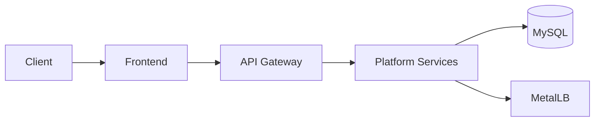

# Alif Private Cloud Kubernetes Deployment

Kubernetes manifests for deploying the Alif application stack on a private cloud environment.

## Overview

This repository contains the Kubernetes resources required to deploy the Alif platform, including:

- Namespace definition
- MetalLB configuration for LoadBalancer exposure
- MySQL database resources
- Shared application secrets
- Frontend deployment
- API Gateway
- Discovery Server
- User Service
- Donation Service
- Food Stock Service
- Intervention Service
- Lost Animal Service
- Street Reporting Service

## Architecture



## Repository Structure

- `namespace.yaml` namespace bootstrap
- `metallb/` load balancer configuration
- `mysql/` database manifests
- `shared/` shared resources and secret templates
- `frontend/` frontend workload manifests
- `api-gateway/` gateway manifests
- `discovery-server/` discovery service manifests
- `user-service/` user service manifests
- `donation-service/` donation service manifests
- `food-stock-service/` food stock service manifests
- `intervention-service/` intervention service manifests
- `lost-animal-service/` lost animal service manifests
- `street-reporting/` reporting service manifests
- `vetnetwork-service/` vet network service manifests

## Deployment Notes

- Keep secret values outside Git
- Apply the namespace and shared resources before the application workloads
- Validate image tags and service names before applying overlays

## Branching and Commits

- Use branches such as `feat/<area>`, `fix/<area>`, `docs/<area>`, or `k8s/<area>`
- Keep commits tied to one manifest or one deployment concern
- Prefer Conventional Commits such as `chore(k8s): update gateway image tag`
- Avoid generic messages like `update`, `final`, or `test`

## Contributing

- Update only the manifests that are relevant to the change
- Keep runtime secrets and local kubeconfig files out of the repository
- Document rollout risk when changing shared infrastructure resources
- Vet Network Service

## Repository Structure

```text
k8s/
|-- namespace.yaml
|-- metallb/
|-- mysql/
|-- shared/
|-- frontend/
|-- api-gateway/
|-- discovery-server/
|-- user-service/
|-- donation-service/
|-- food-stock-service/
|-- intervention-service/
|-- lost-animal-service/
|-- street-reporting/
`-- vetnetwork-service/
```

## Prerequisites

- A working Kubernetes cluster
- `kubectl` configured against the target cluster
- MetalLB installed in the cluster
- Container image access for the referenced application images

## Before Deployment

1. Copy the example secret files and replace placeholder values:

```powershell
Copy-Item .\shared\app-secrets.example.yaml .\shared\app-secrets.yaml
Copy-Item .\mysql\mysql-secret.example.yaml .\mysql\mysql-secret.yaml
```

2. Update the MetalLB address pool in [metallb/ipaddresspool.yaml](/D:/Alif.tn-App-main/k8s/metallb/ipaddresspool.yaml) if your private cloud uses a different IP range.

3. Review container image tags if you want to deploy versions other than `:dev`.

## Deployment Order

Apply the manifests in a safe order:

```powershell
kubectl apply -f .\namespace.yaml
kubectl apply -f .\metallb\
kubectl apply -f .\shared\
kubectl apply -f .\mysql\
kubectl apply -f .\discovery-server\
kubectl apply -f .\api-gateway\
kubectl apply -f .\user-service\
kubectl apply -f .\donation-service\
kubectl apply -f .\food-stock-service\
kubectl apply -f .\intervention-service\
kubectl apply -f .\lost-animal-service\
kubectl apply -f .\street-reporting\
kubectl apply -f .\vetnetwork-service\
kubectl apply -f .\frontend\
```

## Notes

- The frontend service is exposed as a `LoadBalancer`.
- Internal services are exposed inside the cluster through Kubernetes services.
- Secret templates are included in this repository, but real credentials should stay local or be managed through a secure secret workflow.
