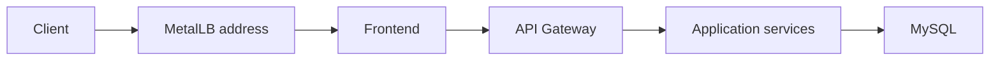

# Alif Private Cloud Kubernetes Manifests

Kubernetes manifests for the Alif application stack in a private cloud lab. This repository contains deployment configuration; it does not include the application source code or evidence of a running cluster.

## Components

- `namespace.yaml`: the `alif` namespace.
- `metallb/`: an address pool and L2 advertisement for the frontend `LoadBalancer` service.
- `mysql/`: MySQL configuration, initialization, a Deployment, and a Service. The file named `mysql-statefulset.yaml` currently defines a **Deployment**, not a StatefulSet.
- `shared/`: an example application Secret. Example secret values must be replaced locally.
- `frontend/`, `api-gateway/`, and `discovery-server/`: entry point and routing services.
- `user-service/`, `donation-service/`, `food-stock-service/`, `intervention-service/`, `lost-animal-service/`, `street-reporting/`, and `vetnetwork-service/`: application workloads and Services.

## Prerequisites

- A Kubernetes cluster and `kubectl` configured for it.
- MetalLB installed before applying the resources in `metallb/`.
- Access to the container images referenced by the manifests.
- A suitable address range in [`metallb/ipaddresspool.yaml`](metallb/ipaddresspool.yaml); the checked-in range is specific to one lab network.

## Before deployment

Review image tags, Service names, ConfigMaps, and Secret references for the target cluster. The `:dev` image tags in the manifests are mutable. The `*.example.yaml` files are templates, not production credentials; create real Secrets through a secure local workflow and keep their values out of Git.

**The current MySQL manifest is for an isolated lab only.** It sets `MYSQL_ALLOW_EMPTY_PASSWORD=yes`, and its data directory uses `emptyDir`, which is lost when the Pod is replaced. The `mysql-secret.example.yaml` template is not wired into the MySQL Deployment. Before using this stack with real data or in a shared environment, replace the empty-password setting with a Secret reference and add persistent storage. Do not describe the current database as durable or secured.

After addressing those limits, apply the namespace first, then MetalLB resources and required Secrets/ConfigMaps, then MySQL and discovery, and finally the gateway, application services, and frontend. Verify workload readiness and Service endpoints with `kubectl` after each stage.

## Contributing

- Keep credentials, local kubeconfig files, and generated artifacts out of the repository.
- Update only the manifests relevant to a change and document any rollout risk.
- Keep the README aligned with the Kubernetes resource kinds and actual Secret references.
