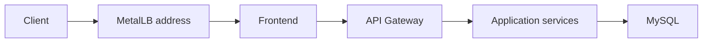

# Alif Private Cloud Kubernetes Manifests

Kubernetes manifests for the Alif application stack in a private cloud lab. This repository contains deployment configuration; it does not include the application source code or evidence of a running cluster.

## Components

- `namespace.yaml`: the `alif` namespace.
- `metallb/`: an address pool and L2 advertisement for the frontend `LoadBalancer` service.
- `mysql/`: MySQL configuration, a Secret template, a PersistentVolumeClaim, a Deployment, and a Service. The file named `mysql-statefulset.yaml` still defines a **Deployment**, not a StatefulSet.
- `shared/`: an example application Secret. Example secret values must be replaced locally.
- `frontend/`, `api-gateway/`, and `discovery-server/`: entry point and routing services.
- `user-service/`, `donation-service/`, `food-stock-service/`, `intervention-service/`, `lost-animal-service/`, `street-reporting/`, and `vetnetwork-service/`: application workloads and Services.

## Prerequisites

- A Kubernetes cluster and `kubectl` configured for it.
- MetalLB installed before applying the resources in `metallb/`.
- Access to the container images referenced by the manifests.
- A suitable address range in [`metallb/ipaddresspool.yaml`](metallb/ipaddresspool.yaml); the checked-in range is specific to one lab network.

## Before deployment

Review image tags, Service names, ConfigMaps, and Secret references for the target cluster. The `:dev` image tags in the manifests are mutable. The `*.example.yaml` files are templates, not production credentials. Create `mysql/mysql-secret.yaml` and `shared/app-secrets.yaml` from the templates with real values in a secure local workflow; both target paths are ignored by Git. Never apply the example files with their placeholder values.

The MySQL Deployment reads root and application passwords from `mysql-secret`. It sets `MYSQL_ROOT_HOST=localhost` and creates the `alif` database user for application services on a **new** data volume. Its data directory uses the `mysql-data` PVC; the cluster needs a working default StorageClass or an appropriate `storageClassName` in [`mysql/mysql-pvc.yaml`](mysql/mysql-pvc.yaml). The application services read the same application password from `mysql-secret`.

**Existing installations require a migration plan.** The previous manifest used an empty password, remote root access, and ephemeral `emptyDir` storage. Applying the new Deployment will not copy data from the old Pod. Export data before changing the workload and restore it into the new PVC. MySQL initialization variables only affect a new data directory; if reusing an initialized database, rotate its credentials and remove any old remote root account manually.

For a new installation, apply the namespace first, then MetalLB resources, the real Secrets, the MySQL ConfigMap and PVC, the MySQL Deployment and Service, and finally discovery, gateway, application services, and frontend. Do not use `kubectl apply -f mysql/` or `kubectl apply -f shared/`: those directories contain example Secret files. Verify PVC binding, MySQL readiness, and application Service endpoints with `kubectl` after each stage.

## Contributing

- Keep credentials, local kubeconfig files, and generated artifacts out of the repository.
- Update only the manifests relevant to a change and document any rollout risk.
- Keep the README aligned with the Kubernetes resource kinds and actual Secret references.
